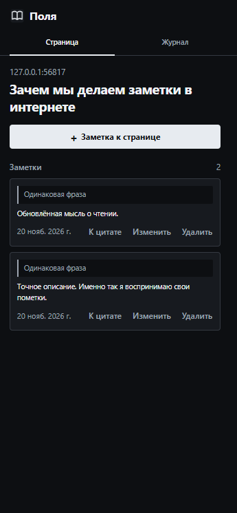
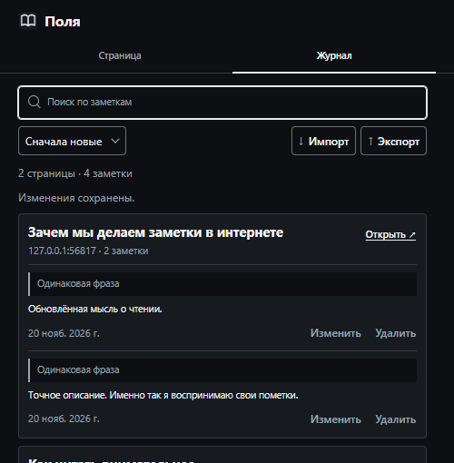

# Поля

«Поля» — расширение для Google Chrome, в котором можно оставлять личные заметки прямо во время чтения. Привяжите комментарий к цитате, изображению или странице целиком. Все заметки собраны в журнале боковой панели.

[Скачать готовую сборку 0.2.0](https://github.com/dubinins130-glitch/Polya/releases/download/v0.2.0/Polya-0.2.0-chrome.zip) · [Все версии](https://github.com/dubinins130-glitch/Polya/releases)

## Возможности

- **Заметки к тексту.** Выделите фрагмент и нажмите «+ Заметка» или `Alt+Shift+M`. Чтобы сохранить комментарий, нажмите «Сохранить» или `Ctrl+Enter`. Команда «К цитате» возвращает к найденному месту на странице.
- **Заметки к изображениям.** Нажмите правой кнопкой на изображении и выберите «Добавить заметку в Поля». Команда «К изображению» возвращает к картинке, если её удалось найти.
- **Заметки к странице.** Нажмите «Заметка к странице» на вкладке «Страница» в боковой панели.
- **Общий журнал.** Просматривайте, редактируйте и удаляйте заметки со всех сайтов. Поиск работает по заголовку страницы, адресу, цитате и комментарию.
- **Резервные копии.** Экспортируйте заметки в JSON и импортируйте их обратно. При совпадении с существующей заметкой сохраняется локальная запись.

Заметки хранятся в профиле браузера. Подробнее о данных и разрешениях в [политике конфиденциальности](PRIVACY.md).

## Скриншоты

| Заметки к текущей странице | Журнал со всех сайтов |
| --- | --- |
|  |  |


## Установка готовой сборки

Нужен Google Chrome 116 или новее.

1. Скачайте архив из [GitHub Releases](https://github.com/dubinins130-glitch/Polya/releases) и распакуйте его в отдельную папку.
2. Откройте `chrome://extensions` и включите «Режим разработчика».
3. Нажмите «Загрузить распакованное расширение» и выберите папку, в которой лежит `manifest.json`.
4. Откройте обычную веб-страницу или обновите уже открытую. Нажмите «Поля» в меню расширений Chrome, чтобы открыть боковую панель. Иконку можно закрепить на панели инструментов.

При обновлении распакуйте новую сборку в ту же папку и нажмите «Обновить» на карточке «Поля» в `chrome://extensions`. Заметки можно предварительно экспортировать из журнала.

## Сборка из исходников

Нужны Git и Node.js 24 или новее.

```sh
git clone https://github.com/dubinins130-glitch/Polya.git
cd Polya
npm ci
npm run build
```

Готовое расширение появится в папке `dist`. Чтобы загрузить его в Chrome, выберите эту папку на третьем шаге инструкции выше.

### Тесты

```sh
npm test
npm run test:browser
```

Первая команда проверяет привязку заметок, резервные копии и операции с хранилищем. Вторая собирает расширение и запускает сценарии в установленном Chrome с временным профилем и локальными тестовыми страницами. Для запуска в Chromium установите его командой `npx playwright-core install chromium --no-shell` и задайте переменную окружения `POLYA_BROWSER=chromium`.

## Поддерживаемые страницы

Заметки можно создавать в основном документе обычных HTTP(S)-страниц. Системные страницы Chrome, Chrome Web Store, встроенный просмотрщик PDF, локальные файлы и содержимое iframe недоступны для аннотирования. Если цитата или изображение исчезнет после обновления сайта, комментарий останется в журнале.

## Лицензия

[MIT](LICENSE)
