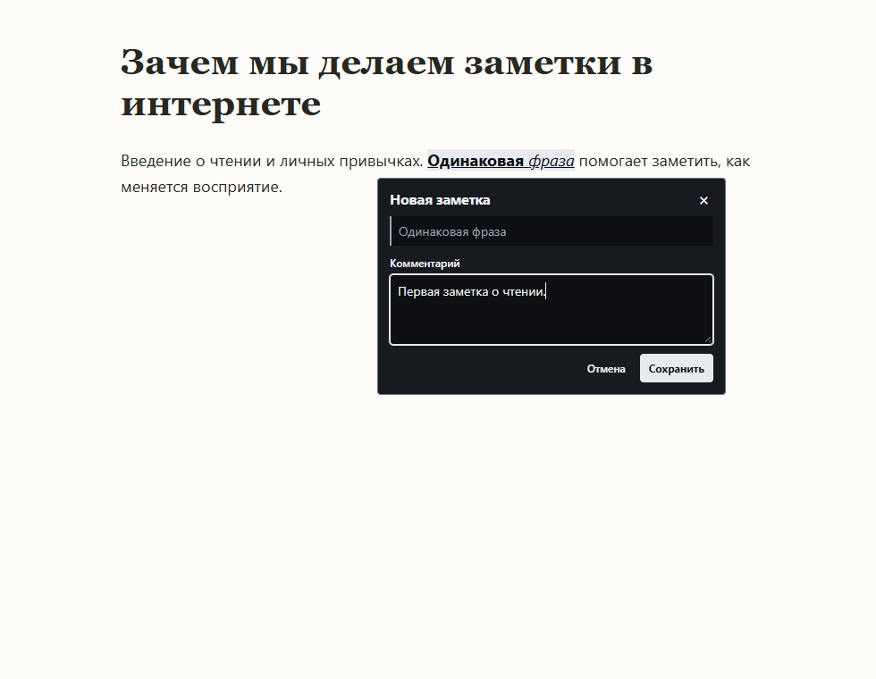

# Поля

В «Полях» можно оставить заметку к фразе, картинке или странице целиком. Например, выделить абзац в статье и записать, почему он пригодится. Заметка сохранится в Chrome, а из боковой панели можно вернуться к цитате.

[Скачать сборку 0.2.0 для Chrome](https://github.com/dubinins130-glitch/Polya/releases/download/v0.2.0/Polya-0.2.0-chrome.zip) · [Все версии](https://github.com/dubinins130-glitch/Polya/releases)

## Как делать заметки

- Выделите текст и нажмите «+ Заметка» или `Alt+Shift+M`. В редакторе можно сохранить запись сочетанием `Ctrl+Enter`.
- Для картинки откройте меню правой кнопкой мыши и выберите «Добавить заметку в Поля».
- Чтобы записать мысль о странице целиком, откройте боковую панель и нажмите «Заметка к странице».

На вкладке «Страница» видны заметки к открытой веб-странице. Кнопки «К цитате» и «К изображению» прокручивают её до сохранённого места, если его удалось найти. На вкладке «Журнал» собраны записи со всех сайтов. Их можно искать по заголовку страницы, адресу, цитате и тексту заметки, а также редактировать и удалять.

Если нужно перенести заметки в другой профиль, выгрузите их в JSON и импортируйте файл там. При совпадении остаётся запись из текущего профиля. О том, какие данные хранят «Поля», рассказано в [политике конфиденциальности](PRIVACY.md).

## Скриншоты

| Заметки к текущей странице | Журнал со всех сайтов |
| --- | --- |
|  |  |



## Установка готовой сборки

Нужен Google Chrome 116 или новее.

1. Скачайте ZIP из [раздела релизов](https://github.com/dubinins130-glitch/Polya/releases) и распакуйте его.
2. Откройте `chrome://extensions` и включите «Режим разработчика».
3. Нажмите «Загрузить распакованное расширение» и выберите папку, в которой лежит `manifest.json`.
4. Откройте веб-страницу или обновите уже открытую. Выберите «Поля» в меню расширений Chrome. Откроется боковая панель.

Для обновления распакуйте новую сборку в ту же папку. Затем откройте `chrome://extensions` и нажмите кнопку со стрелкой по кругу на карточке «Поля». Перед этим можно сделать копию заметок через «Экспорт» в журнале.

## Сборка из исходников

Нужны Git и Node.js 24 или новее.

```sh
git clone https://github.com/dubinins130-glitch/Polya.git
cd Polya
npm ci
npm run build
```

Для установки через `chrome://extensions` выберите папку `dist`.

### Тесты

```sh
npm test
npm run test:browser
```

`npm test` проверяет привязку заметок, импорт, экспорт и работу с хранилищем. Команда `npm run test:browser` собирает расширение и проверяет его в Chrome на локальных страницах с временным профилем.

Для тестов в Chromium выполните `npx playwright-core install chromium --no-shell` и задайте `POLYA_BROWSER=chromium` перед запуском `npm run test:browser`.

## Поддерживаемые страницы

«Поля» работают с основным документом веб-страницы, открытой по HTTP или HTTPS. Страницы настроек Chrome, Chrome Web Store, встроенный просмотрщик PDF, локальные файлы и содержимое iframe недоступны для заметок. Если сайт изменится и цитата или картинка пропадёт, запись останется в журнале.

## Лицензия

[MIT](LICENSE)
